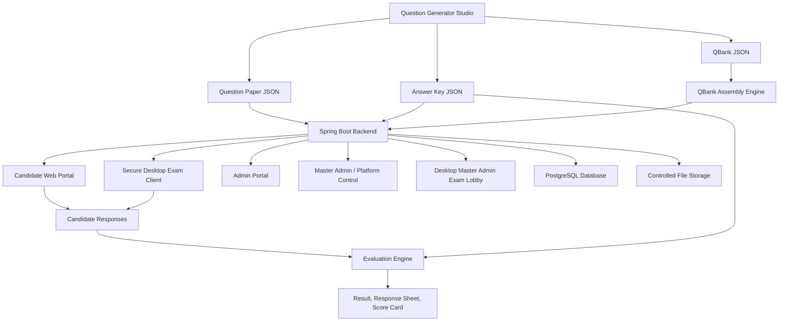

# Secure Assessment Conducting Services

## Product Description

Secure Assessment Conducting Services is an end-to-end assessment operations suite for institutes, coaching systems, entrance tests, recruitment tests, and controlled computer-based examinations.

It is designed to manage the full exam lifecycle:

- question creation and paper preparation
- question-bank based paper assembly
- candidate registration
- secure exam delivery
- response capture
- answer-key based evaluation
- candidate response sheets
- score cards
- branded paper and key publication
- admin, master-admin, and desktop operator workflows

The product is not just a quiz app. It is a complete examination workflow platform with a browser layer, backend server, database, secure desktop exam client, desktop operator console, PDF publishing, qbank assembly, answer-key challenge flow, and evaluation engine.

## Product Positioning

Short product line:

> A secure white-labelled assessment platform for question-bank creation, exam delivery, evaluation, and branded result publication.

Long product line:

> Secure Assessment Conducting Services provides institutes with a controlled examination environment where question papers can be generated, assembled, delivered, evaluated, audited, and published through one connected platform.

## Primary Users

- Institute owners and examination authorities
- Master administrators
- Exam administrators
- Center operators and invigilators
- Paper setters
- Evaluation teams
- Candidates

## Main Product Modules

### 1. Question Generator Studio

The Question Generator Studio is the paper-authoring side of the product. It is used to build structured question papers with:

- question frames
- option frames
- math expressions
- figures and imported images
- circuit diagrams
- answer keys
- branded PDF exports
- JSON exports for exam hosting

The studio exports exam-ready question paper JSON and answer-key JSON. These exports are used by the backend exam platform.

### 2. Question Bank Assembly

The qbank system allows a large bank of questions to be uploaded and analyzed by:

- subject
- section
- topic
- marks
- difficulty
- question type

Admin can assemble a paper from the bank based on a blueprint. This supports controlled randomization while keeping the selected paper and selected answer key traceable.

### 3. Candidate Portal

The candidate portal supports:

- registration
- login
- application number flow
- correction window
- dashboard
- admit/exam access
- response sheet
- result
- score-card download
- answer-key challenge
- password reset

Candidate-facing pages are kept separate from admin and master-admin surfaces.

### 4. Web Exam UI

The browser-based exam UI supports:

- question rendering
- option rendering
- NAT numeric answers
- MCQ and MSQ answers
- section navigation
- question palette
- instructions
- question paper view
- calculator
- mark for review
- save and next
- auto-submit / final submit

Questions and responses are stored using authoritative question IDs, not just displayed question numbers.

### 5. Secure Desktop Exam Client

The desktop exam client is a Windows application intended for controlled exam delivery. It provides:

- secure exam entry
- full-screen exam shell
- WebView2-based exam rendering
- native guard integration
- remote/debug detection hooks
- desktop-only controlled flow
- kiosk-style submit and end screens
- NAT keypad and calculator support

Artifact path:

`D:\exam-platform-backend\desktop\artifacts\SecureExamClient`

### 6. Master Admin Exam Lobby

The Master Admin Exam Lobby is a separate desktop operator console for protected exam operations.

It supports:

- desktop-gated admin access
- protected master console access
- protected exam admin console access
- active exam monitoring
- incident visibility
- candidate rejoin/re-exam request workflows
- signed desktop console communication

Artifact path:

`D:\exam-platform-backend\desktop\artifacts\MasterAdminExamLobby`

### 7. Admin Portal

The admin portal manages:

- exam creation
- exam mode
- registration window
- launch controls
- question paper upload
- answer key upload
- qbank upload
- qbank assembly
- evaluation
- response center
- candidate records
- notifications
- PDF notice/brochure uploads
- score-card branding
- answer-key challenge review

### 8. Master Admin / Platform Control

The master/admin control layer is intended for higher-authority workflows:

- institute onboarding
- admin creation
- access revocation
- service allocation
- platform-level control
- desktop console enrollment
- operator-level security governance

## Technology Stack

### Backend

- Java 25
- Spring Boot 4.0.5
- Spring Web MVC
- Spring Security
- Spring Data JPA
- Spring Validation
- Spring Mail
- Jackson
- Apache PDFBox
- Bouncy Castle

### Database

- PostgreSQL for persistent runtime data
- H2 for local/test usage

### Frontend

- HTML
- CSS
- Vanilla JavaScript
- Static pages served by the Spring Boot backend

### Desktop

- C# / .NET 8
- WPF
- WebView2
- C++ native guard DLL
- CMake for native build

### Document and Export Layer

- PDFBox for backend PDF workflows
- browser/canvas-generated assets from the question generation pipeline
- JSON-based question paper and answer-key exchange

### AI / Model Usage

The current core product does not depend on a hosted AI model to conduct or evaluate exams. Exam delivery, storage, and evaluation are deterministic backend workflows. Any AI-assisted content creation would be an optional authoring-side enhancement, not a dependency of the secure exam runtime.

## Architecture Overview

## Product Usage Flow

### Direct Paper Flow

1. Paper setter creates the exam in Question Generator Studio.
2. Studio exports question paper JSON and answer-key JSON.
3. Admin creates an exam in the backend.
4. Admin uploads the paper and key.
5. Admin opens registration and launch controls.
6. Candidate registers and receives application access.
7. Candidate takes the exam through web UI or desktop secure client.
8. Responses are saved against real question IDs and option IDs.
9. Evaluation uses the uploaded answer key.
10. Admin releases response sheet, result, score card, paper, or key as needed.

### QBank Assembly Flow

1. Paper setter exports a full qbank and full default answer key.
2. Admin uploads the qbank to the backend.
3. Backend analyzes topic, difficulty, marks, and section availability.
4. Admin defines the exam blueprint.
5. Backend assembles a selected paper and selected answer key.
6. Selected paper is published to the live exam.
7. Candidate receives shuffled/display-mapped questions.
8. Responses are saved with authoritative global question IDs.
9. Evaluation uses the selected key, not display question numbers.
10. Final paper and final answer key can be published after the exam.

### Candidate Answer-Key Challenge Flow

1. Admin opens a challenge window.
2. Candidate views response sheet and released key.
3. Candidate selects the displayed question to challenge.
4. Candidate uploads compulsory PDF proof and optional notes/images if enabled.
5. Admin reviews challenge records.
6. Admin accepts or rejects a challenge.
7. Evaluation can apply final-key decisions such as corrected key, marks-to-all, or dropped question.

## Security Feature Breakdown

### 1. Role Separation

The platform separates:

- candidate pages
- admin pages
- master-admin pages
- desktop-only operator access
- public service request pages

This avoids treating every authenticated user as equally powerful.

### 2. Spring Security Layer

The backend uses Spring Security for authentication, session handling, route protection, and role-based controls.

Security behavior includes:

- protected admin routes
- protected master-admin routes
- controlled public routes
- session handling
- role-based authorization

### 3. Public API Boundary

The public API boundary restricts which endpoints are available without admin authority. This helps prevent accidental exposure of sensitive backend actions.

### 4. CSRF Protection

The platform contains dedicated CSRF filters for candidate/admin workflows. This reduces the risk of forged requests against authenticated sessions.

### 5. Rate Limiting

Rate limiting exists to slow brute-force and repeated abuse attempts on sensitive flows.

### 6. Security Headers

The backend applies modern browser security headers such as:

- Content Security Policy
- HSTS
- Referrer Policy
- Permissions Policy
- Cross-Origin policies

These reduce exposure to common browser-side attacks.

### 7. Desktop Console Signature Gate

Sensitive desktop-console operations are protected with signed request headers. The desktop lobby signs requests and the backend verifies them.

This protects operator functions from being casually opened in a normal browser.

### 8. Desktop Device Enrollment

The desktop console flow includes device-aware enrollment and active/revoked device state.

This allows the platform to recognize authorized desktop clients and revoke devices when needed.

### 9. Admin Network Allowlist

The backend can restrict admin/master-admin access to specific IP addresses or networks.

This is useful for:

- exam centers
- control rooms
- private LAN deployment
- limited-operator access

### 10. File Storage Guarding

Candidate uploads, paper assets, answer keys, response artifacts, and branding assets are not intended to be exposed as simple public file paths.

The platform routes access through controlled backend logic instead of open directory browsing.

### 11. Candidate Secure Session Flow

Candidate exam access is based on verified candidate records and session/token checks.

The exam flow stores:

- real question ID
- displayed question number
- selected option IDs
- NAT answer values
- time/status metadata

This protects evaluation from relying only on visible question numbering.

### 12. Authoritative Evaluation

Evaluation is performed by the backend against authoritative IDs:

- global question IDs
- option IDs
- selected paper key
- direct paper key
- NAT answer rules

This is important because a displayed `Q.1` for a candidate is not always the same as global paper question 1.

### 13. NAT Range Evaluation

NAT evaluation supports:

- exact numeric values
- decimal equivalence such as `0.1` and `0.10`
- positive ranges
- reversed ranges
- negative ranges
- signed candidate inputs

Examples:

- `412-414` accepts `412`, `413`, and `414`
- `414-412` works the same way
- `-25 to -21` accepts values inside that negative range
- `0.10` matches `0.1`

### 14. Desktop Native Guard

The desktop client includes a native C++ guard DLL with hooks for detecting:

- debugger presence
- remote session indicators

This is an exam-client hardening layer. It is useful, but it should be treated as one layer inside a larger security design, not as a claim that the endpoint is impossible to attack.

### 15. Kiosk-Style Exam Flow

The desktop exam client supports a controlled exam flow:

- full-screen exam shell
- restricted navigation
- controlled submit flow
- desktop-delivered exam page
- post-submit review/end screen

This improves the exam experience in controlled labs.

### 16. Audit-Oriented Design

The platform stores meaningful records for:

- candidate registration
- exam attempts
- responses
- selected question IDs
- answer status
- evaluation result
- challenge records
- incidents and rejoin requests
- admin/operator action surfaces

This gives the product an audit trail instead of only a final score.

## Important Security Honesty

No serious exam platform should be marketed as unhackable.

The correct claim is:

> The platform is built with layered application security, desktop-gated operator access, controlled file access, authoritative ID-based evaluation, and deployment support for LAN/IP-restricted exam environments.

Production-grade security still depends on:

- HTTPS / TLS setup
- database password and secret management
- secure server hosting
- operating system lockdown
- USB/device policy
- network isolation
- firewall rules
- monitoring and logging
- backup policy
- operator discipline

## Product Strengths

- End-to-end assessment lifecycle in one suite
- Question Generator Studio integration
- image-rich and equation-rich question support
- qbank assembly with topic/difficulty/marks logic
- web and desktop exam delivery
- desktop operator lobby
- answer-key challenge workflow
- branded question paper, answer key, response sheet, and score-card outputs
- authoritative ID-based evaluation
- NAT numeric range handling
- candidate response sheet generation
- master-admin and admin separation
- desktop-only protected admin access path

## Product Usage Cases

The platform can be used for:

- university entrance exams
- department-level admission tests
- coaching institute tests
- scholarship exams
- recruitment assessments
- lab-based secure tests
- mock GATE/JEE-style CBT exams
- internal certification exams

## Deployment Shape

### Local / Prototype Deployment

The current development deployment runs:

- Spring Boot backend on `localhost:8081`
- PostgreSQL database
- static web portals
- desktop clients connected to the local backend

### Center / LAN Deployment

A stronger deployment can run:

- central backend server on a private LAN
- admin/master consoles on approved machines
- candidate clients on locked center machines
- IP allowlisting for operator controls
- desktop secure exam client for candidates
- database and file storage on protected server

### Future Production Deployment

A production deployment should add:

- HTTPS everywhere
- reverse proxy
- managed secrets
- device certificates or per-install signing keys
- central log collection
- backup and restore process
- stronger endpoint lockdown
- dedicated monitoring dashboard

## Competitive Differentiation

Most small exam systems are only one of these:

- quiz page
- registration form
- PDF generator
- result calculator
- candidate database

This product combines all of those into one workflow:

- author paper
- assemble paper
- host exam
- capture response
- evaluate
- publish branded outputs
- audit and challenge
- operate through desktop-controlled consoles

That is the difference between a simple test app and an exam operations platform.

## Product Summary

Secure Assessment Conducting Services is a full exam platform built around controlled paper generation, secure candidate delivery, authoritative evaluation, branded publishing, and operator governance.

Its strongest product value is that the exam lifecycle stays connected from paper creation to final publication. The system knows which paper was published, which question IDs were delivered, which option IDs were selected, how answers were evaluated, and which final artifacts were released.

That connected trace is what makes the platform more serious than a normal quiz application.
