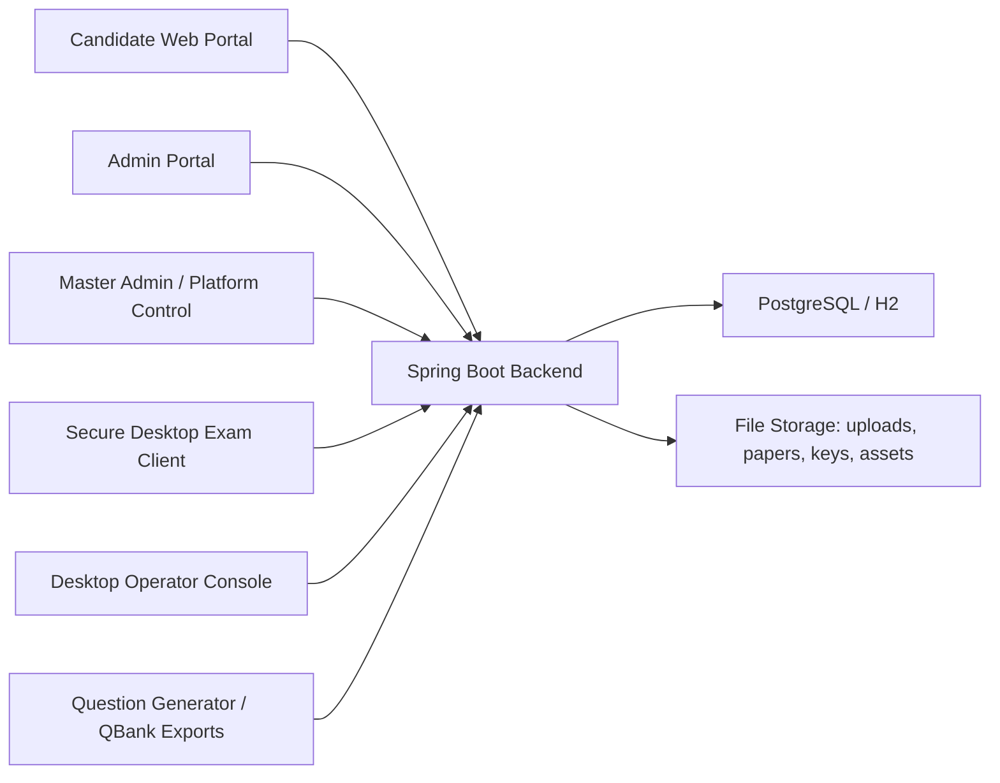

# Secure Assessment Conducting Services

## Product Overview

Secure Assessment Conducting Services is a multi-surface examination platform designed for the full assessment lifecycle:

- question paper and answer-key generation
- branded exam publication
- candidate registration and secure delivery
- live exam execution
- response capture and evaluation
- post-exam publication, score cards, and audit trails

The product is not a single page or a single app. It is a suite made of:

- a Spring Boot backend
- candidate-facing web portals
- admin and master-admin control surfaces
- a desktop secure exam client
- a desktop master-admin / operator console
- a companion question-generation and question-bank workflow

This repository currently contains the backend platform, web portals, qbank assembly pipeline, evaluation engine, report publishing flow, and the desktop operator / exam clients.

## What Is Inside The Project

### 1. Candidate Portal

Candidate-facing web flows include:

- public landing page
- registration workflow
- candidate login
- correction window
- candidate dashboard
- exam lobby
- exam interface
- response sheet
- result page
- score-card download
- password-reset flow with captcha

Files are served from `src/main/resources/static`, with candidate screens such as:

- `candidate-registration.html`
- `candidate-dashboard.html`
- `candidate-exam-lobby.html`
- `candidate-exam.html`
- `candidate-responses.html`
- `candidate-result.html`

### 2. Admin Portal

The exam admin portal supports:

- exam creation and config
- candidate operations
- notification workflows
- response viewing
- evaluation
- answer-key upload
- original paper / original key release
- qbank assembly and publishing
- report-card template release
- incident visibility

Key admin entry pages:

- `admin-7xk92q-portal.html`
- `admin.html`

### 3. Master Admin / Platform Control

The higher control layer includes:

- platform-level service requests
- institute onboarding
- master-admin access control
- secure operator gating
- master-admin specific control pages

Relevant pages:

- `master-admin.html`
- `platform-control.html`
- `service-request.html`

### 4. Secure Desktop Exam Client

The desktop exam client is intended for controlled exam delivery on Windows. It is a separate packaged application and includes:

- secure exam entry
- candidate login / DOB flow
- full-screen exam execution shell
- timer and question palette
- instructions and question paper support
- on-screen NAT keypad
- scientific calculator integration
- native guard hooks for debugger / remote-session detection

Artifact path:

- `desktop/artifacts/SecureExamClient`

### 5. Desktop Master Admin / Exam Lobby Console

A separate Windows desktop operator console exists for protected control-room style operations.

Artifact path:

- `desktop/artifacts/MasterAdminExamLobby`

### 6. Question Bank and Paper Assembly

The platform supports server-side qbank workflows, including:

- upload of full qbank JSON
- upload of full-bank default answer key
- qbank inventory analysis
- topic / difficulty / marks based selection
- selected paper assembly
- selected key assembly
- branded PDF export
- publishing of selected paper to a live exam
- post-exam final-key aggregation from published question IDs

The qbank flow lives primarily in:

- `src/main/java/com/shashwat/examplatformbackend/qbank`

### 7. Evaluation Engine

The evaluation subsystem supports:

- MCQ evaluation
- MSQ evaluation
- NAT evaluation
- result generation
- response sheet scoring
- score-card preview and PDF output

The NAT engine now supports:

- exact numeric equivalence such as `0.1 == 0.10`
- inclusive numeric ranges such as `412-414`
- reversed ranges such as `414-412`
- signed ranges such as `-21 to -25`
- negative values in candidate responses

Main evaluation package:

- `src/main/java/com/shashwat/examplatformbackend/evaluation`

### 8. Report Card and PDF Publishing

The platform includes branded PDF generation for:

- question paper PDFs
- answer-key PDFs
- selected qbank paper PDFs
- selected qbank key PDFs
- candidate score cards

Branding supports institute-level assets such as:

- institute name
- exam name
- subtitle
- logo / banner
- watermark text or image
- authority name
- authority designation
- authority signature
- validity text

## Major Functional Areas

### Question Generation and QBank Workflow

At suite level, the product is designed to work with a question generator studio that exports:

- question paper JSON
- answer-key JSON
- branded paper assets
- image-rich and equation-rich questions

Within this backend, that exported material is then used for:

- direct exam hosting
- qbank analysis
- selective server-side paper assembly
- post-exam final-paper and final-key workflows

### Exam Delivery

The platform supports both:

- browser-based candidate exam delivery
- desktop secure exam delivery

### Response and Evaluation

The platform stores candidate answers, marks them, and produces:

- evaluated response views
- result summaries
- released answer-key visibility
- printable score cards

### Branding and White-Labelling

This system is meant to be white-labelled for different institutes and exams. Branding exists across:

- public portal
- exam UI
- PDFs
- report cards
- desktop exam header/banner

## Technology Stack

### Backend

- Java 25
- Spring Boot 4.0.5
- Spring Security
- Spring Data JPA
- Spring Validation
- Spring Web MVC
- Spring Mail
- Jackson
- Apache PDFBox
- Bouncy Castle

### Database

- PostgreSQL for runtime / production-style persistence
- H2 for local development and console usage

### Frontend

- HTML
- CSS
- Vanilla JavaScript

The web layer is mostly server-hosted static frontends with API-driven behavior.

### Desktop

- .NET 8 WPF
- WebView2
- native C++ guard DLL

Desktop project roots:

- `desktop/src/QSStudio.Desktop`
- `desktop/src/MasterAdmin.ExamLobby`
- `desktop/native/QSStudio.NativeGuard`

## Architecture Design

### High-Level Architecture

### Backend Module Layout

The backend is organized into functional packages:

- `auth` for authentication support
- `common` for shared utilities
- `config` for security and system filters
- `desktopconsole` for signed desktop console device handling
- `evaluation` for marking, result, and score-card logic
- `exam` for exam configuration and paper ownership
- `examaccess` for access / rejoin style workflows
- `masteradmin` for master-admin operations
- `notification` for outbound notifications
- `ops` for operational flows
- `platform` for institute service-request handling
- `qbank` for question-bank assembly and publication
- `response` for answer capture and exam submission data
- `student` for candidate registration and candidate records
- `tools` for internal helpers

### Persistence Model

The system uses a mixed storage model:

- relational persistence for exams, candidates, submissions, assemblies, and access records
- controlled file storage for uploads, papers, answer keys, original documents, and branding assets

This is practical for an exam platform because rich documents and image-heavy assets are large, while identity, response, and evaluation records remain relational and queryable.

## Security Posture

### Important Note

This platform has several meaningful hardening layers, but no honest system should be described as "unhackable". The right way to describe it is:

- hardened for controlled deployment
- significantly safer than a basic CRUD portal
- still dependent on deployment quality, operator discipline, secrets handling, OS policy, network policy, and infrastructure setup

### Security Controls Currently Present

#### 1. Role-Based Access Control

The backend separates:

- public candidate access
- admin access
- master-admin access

Protected routes are enforced in `SecurityConfig.java`.

#### 2. Public API Boundary

`PublicApiBoundaryFilter` blocks accidental expansion of the public API surface. Only explicitly allowed public endpoints are exposed.

#### 3. Desktop Console Gate

`DesktopConsoleGateFilter` restricts sensitive operator actions to authorized desktop consoles using:

- signed desktop headers
- timestamp validation
- nonce usage
- device-aware verification
- optional HMAC fallback

This is one of the most important protections in the current operator architecture.

#### 4. Admin Network Allowlist

`AdminNetworkAllowlistFilter` can restrict admin and master-admin actions to approved IP addresses or CIDR ranges.

This is useful for:

- control-room style deployment
- center-based operation
- restricting admin tools from public networks

#### 5. Security Headers

The backend sets protective headers such as:

- HSTS
- CSP
- Referrer-Policy
- Permissions-Policy
- Cross-Origin-Opener-Policy
- Cross-Origin-Resource-Policy

#### 6. Session Controls

The platform uses:

- authenticated sessions
- session fixation migration
- maximum active session limits

#### 7. Password Handling

Passwords are handled through a dedicated secure encoder and the project is structured for strong password policy / secure login behavior rather than plain storage.

#### 8. Hidden Storage Paths

Direct file-serving paths like uploads, papers, keys, and original documents are denied through the normal public route surface.

#### 9. Candidate Password Reset Flow

The product includes:

- candidate reset request flow
- confirmation flow
- captcha support
- email-based recovery path

#### 10. Desktop Native Guard

The native DLL currently exposes detection hooks for:

- remote-session detection
- debugger detection

This is not yet a full anti-cheat kernel product, but it is an operator-side hardening layer for the desktop exam path.

### Security Strengths

Strong areas in the current design:

- multiple operator layers instead of one flat admin panel
- explicit public/private boundary
- network allowlisting support
- signed desktop-console gating
- branded but controlled candidate/public surfaces
- support for desktop-controlled delivery
- file-system path guarding around stored exam assets

### Security Limits and Honest Production Notes

Areas that still depend on disciplined deployment or future hardening:

- TLS and reverse-proxy setup
- infrastructure isolation
- secret rotation
- endpoint logging and SIEM integration
- antivirus / kiosk / USB control at OS layer
- stronger desktop anti-tamper and anti-screen-capture controls
- deeper device attestation
- hardware-backed key storage
- centralized audit dashboards

In short:

- the software already contains strong application-layer controls
- full exam-center grade security still depends on deployment architecture and endpoint hardening

## Product Specialities

What makes the product distinctive:

- full-stack exam workflow instead of only registration or only testing
- qbank-driven server paper assembly
- post-exam final-paper and final-key generation
- branded PDF ecosystem
- candidate web + desktop exam delivery paths
- NAT / numeric answer support including signed ranges
- report-card generation built into the same system
- white-labelling support for institutes
- modular growth path toward stronger operator consoles and stricter desktop execution

## Intended Deployment Model

The platform is suitable for:

- institute-level secure tests
- department / stream-wise entrance exams
- controlled lab-based exams
- qbank-driven randomized paper generation
- white-labelled exam hosting service offerings

## Current Desktop Deliverables

Packaged desktop outputs available in this workspace:

- `desktop/artifacts/SecureExamClient`
- `desktop/artifacts/MasterAdminExamLobby`
- `desktop/artifacts/QSStudio.Desktop`

## Suggested Product Positioning

If presented as a product, this suite can be described as:

> A white-labelled secure assessment platform for registration, exam delivery, qbank-driven paper assembly, evaluation, branded publishing, and operator-controlled desktop execution.

Shorter positioning line:

> Secure Assessment Conducting Services is an end-to-end examination operations suite combining question-bank intelligence, secure delivery, evaluation, and branded publication.

## Practical Summary

This project is not just an exam page. It is a growing examination operating system made of:

- web portals
- secured admin layers
- desktop operator clients
- question-bank assembly logic
- evaluation engines
- report and PDF publishing tools

Its strongest value is that question preparation, exam delivery, evaluation, and publication are being brought into one coherent platform instead of being scattered across separate tools.
