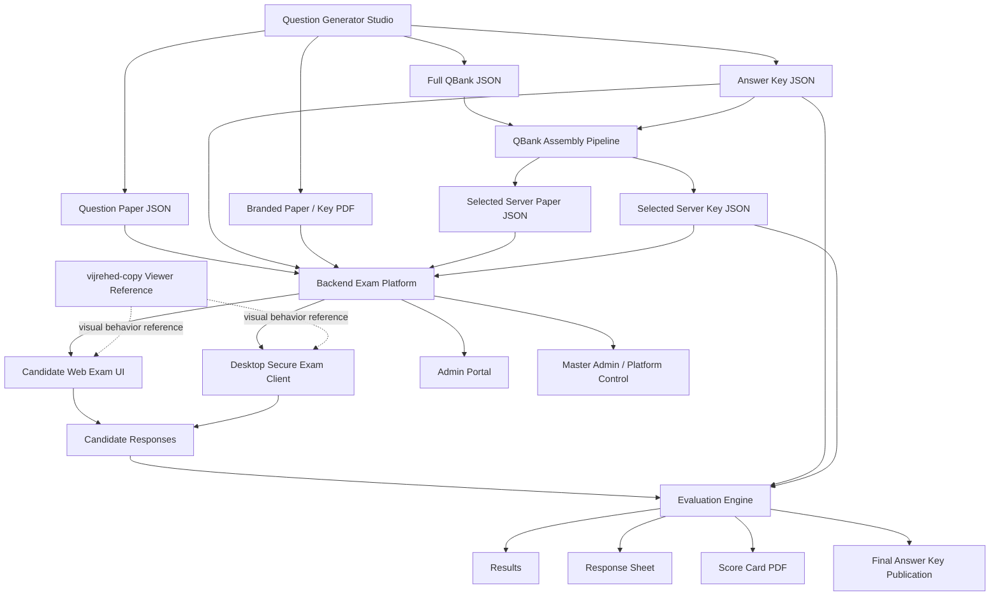
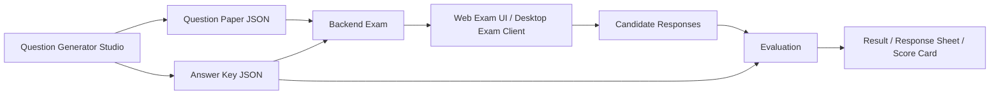
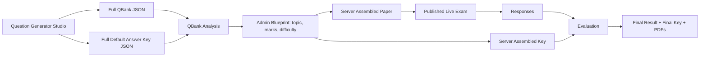
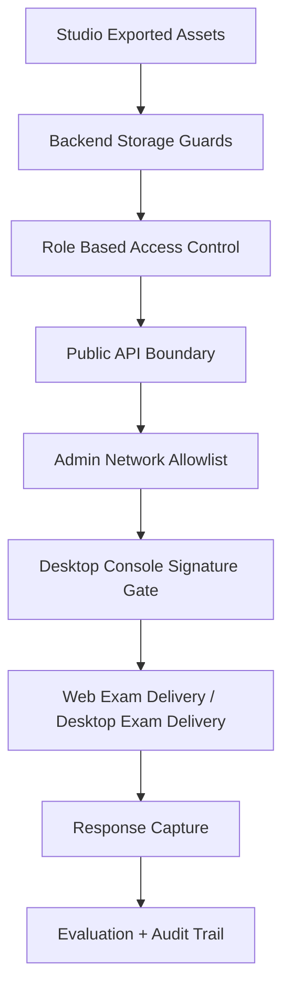

# Prototype Flow

## Purpose

This document describes the practical prototype flow across the major pieces of the assessment suite, especially:

- Question Generator Studio
- `vijrehed-copy` style exam viewer reference
- backend exam platform
- qbank and evaluation pipeline
- desktop secure exam client

It is written as a system-flow note rather than a product brochure.

## Prototype Components

### 1. Question Generator Studio

This is the content-creation side of the suite. It is used to build:

- questions
- options
- figures
- circuit diagrams
- math expressions
- answer keys
- branded paper outputs

Primary outputs from the studio:

- question paper JSON
- answer-key JSON
- branded paper PDF
- branded key PDF
- image-rich question content ready for exam rendering

### 2. `vijrehed-copy` Viewer Reference

This acts as the visual reference model for the exam-rendering experience. It defines the target behavior for:

- question frame layout
- option frame layout
- palette arrangement
- calculator placement
- on-screen NAT keypad style
- instructions / question paper behavior
- scroll and page composition feel

In the prototype chain, `vijrehed-copy` is not the content-authoring tool. It is the rendering and interaction reference.

### 3. Backend Exam Platform

The backend platform receives generated papers, keys, and qbanks, then manages:

- exam config
- candidate lifecycle
- paper publication
- response capture
- evaluation
- report-card publication

### 4. Desktop Secure Exam Client

The desktop client is the controlled-delivery layer. It consumes the backend exam data and is intended to behave like a hardened exam runtime.

### 5. Admin and Master-Admin Control Layers

These layers govern:

- institute setup
- operator actions
- exam configuration
- qbank assembly
- response monitoring
- rejoin / incident workflows
- release control

## End-to-End Prototype Flow

## Prototype Flow In Words

### Stage 1. Authoring

The paper begins inside the Question Generator Studio.

Here the operator creates:

- textual questions
- math-heavy questions
- circuit and figure questions
- options and legends
- answer keys

This stage is where question quality, figure quality, paper branding, and export quality are controlled.

### Stage 2. Export

The studio exports structured assets such as:

- question paper JSON
- answer-key JSON
- qbank JSON
- branded paper and key PDFs

These exports become the source material for the backend.

### Stage 3. Upload Into Backend

The backend ingests these exports and stores them under the exam project. At this stage:

- a direct question paper can be published as-is
- or a full qbank can be analyzed for server-side selection

### Stage 4. QBank Assembly Mode

If qbank mode is used, the backend analyzes the uploaded bank by:

- section
- topic
- marks
- difficulty

The admin then sets the desired blueprint, and the server assembles:

- selected question paper
- selected answer key

This supports controlled randomization without losing answer-key traceability.

### Stage 5. Exam Delivery

The exam can then be delivered through:

- web candidate exam UI
- desktop secure exam client

At the rendering level, the UI behavior should follow the `vijrehed-copy` reference for:

- question layout
- option spacing
- answer palette
- calculator behavior
- NAT keypad behavior

### Stage 6. Response Capture

The candidate performs actions such as:

- mark option
- enter NAT answer
- mark for review
- save and next
- clear response
- submit exam

These are saved into response records linked to question IDs and display order.

### Stage 7. Evaluation

The evaluation engine compares responses against:

- uploaded direct answer key
- or selected qbank answer key
- or final aggregated key based on published selected paper

This stage produces:

- correct / wrong / blank counts
- score
- percentage
- evaluable response sheet
- result view
- report card output

### Stage 8. Publication

After exam completion, the platform can publish:

- candidate responses
- result
- score card
- original answer key
- final paper / final key artifacts

## Prototype Variants

## Variant A. Direct Paper Flow

Used when one fixed paper is created in the studio and published as-is.

## Variant B. QBank Assembly Flow

Used when the final live paper is assembled server-side from a larger bank.

## Relationship Between Studio and Viewer

The clean way to think about the prototype is:

- the Question Generator Studio is the authoring engine
- `vijrehed-copy` is the rendering reference
- the backend is the orchestration and storage engine
- the desktop client is the controlled-delivery shell

So the relationship is not:

- one tool replacing the other

It is:

- one tool creates
- one reference defines exam presentation
- one backend governs lifecycle
- one client delivers under stricter control

## Prototype Security Flow

At prototype level, the security chain looks like this:

This means the platform is trying to protect:

- who can upload papers
- who can publish exams
- who can access admin controls
- who can drive sensitive operator workflows
- how candidate responses are captured and evaluated

## Operational Storyboard

A simple human-readable storyboard:

1. Paper setter creates the exam inside Question Generator Studio.
2. Studio exports question paper JSON, answer-key JSON, and optional full qbank.
3. Backend admin uploads the direct paper or the full qbank.
4. If qbank mode is used, admin selects topic / difficulty / marks blueprint.
5. Backend assembles and publishes the live paper.
6. Candidate logs in through web flow or desktop secure exam client.
7. Exam UI renders questions using the target frame logic inspired by `vijrehed-copy`.
8. Candidate responses are stored against the real question IDs.
9. Evaluation engine marks the responses using the correct key path.
10. Result, response sheet, answer key, and score-card artifacts are released by admin.

## Why This Prototype Design Matters

This flow is useful because it separates concerns well:

- content creation is not mixed with response evaluation
- qbank assembly is not mixed with candidate registration
- rendering reference is not confused with storage logic
- desktop hardening can evolve independently from the studio

That makes the system easier to scale into:

- more institutes
- more exam types
- stronger desktop controls
- richer qbank-driven assembly rules
- stronger publication and audit workflows

## Practical Summary

If reduced to one line, the prototype flow is:

> Studio creates the exam, the viewer defines how it should feel, the backend governs the lifecycle, and the exam client delivers it securely.
